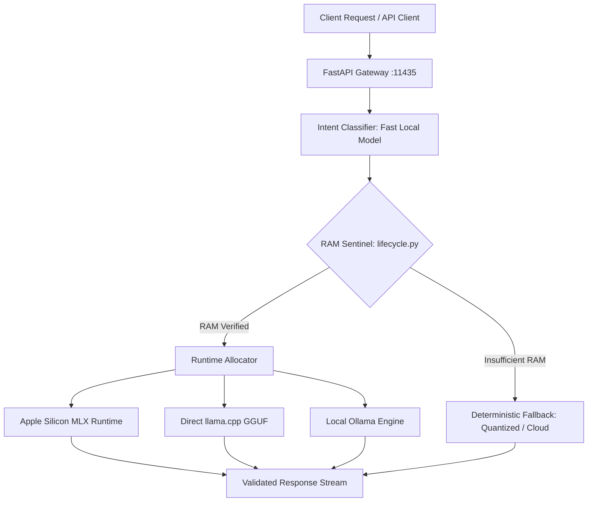

# OpenSpace: Hardware-Aware Edge AI Router & Memory Daemon


%20%7C%20Linux-black?style=flat-square)

OpenSpace is a lightweight, headless inference router and memory daemon designed to prevent Out-Of-Memory (OOM) kernel panics on hardware-constrained edge machines. Rather than dispatching every prompt to a single monolithic model or forcing manual model selection, OpenSpace evaluates system RAM headroom, classifies user intent via a fast local model, and routes inference to specialized local runtimes (Apple Silicon MLX, direct llama.cpp, or Ollama) with automated deterministic fallback chains.

---

## Architecture



---

## Core Engineering Features

- **Hardware-Aware Memory Sentinel (`lifecycle.py`)**: Checks real-time host RAM against known model memory footprints prior to weight allocation. Prevents host panics and swap thrashing by rejecting or downscaling requests when headroom is breached.
- **Provider Abstraction Layer (`providers/`)**: Modular driver architecture supporting Apple Silicon unified memory (`mlx_provider.py`), direct GGUF execution (`llamacpp_provider.py`), and Ollama daemon management (`ollama_provider.py`).
- **Intent-Driven Subagent Routing (`core/orchestrator.py`)**: Automatically routes coding queries to code-specialized models, analytical queries to reasoning models, and general conversational tasks to high-throughput lightweight models.
- **Dynamic Context Budgeting**: Injects full system prompts and persistent context for large-window models while pruning to concise headers for compact models to prevent context clipping.
- **OpenAI-Compatible API**: Fully compatible `/v1/chat/completions` endpoint allows drop-in integration with any standard LLM frontend, IDE extension, or agent framework.

---

## Quickstart

### 1. Clone & Install
```bash
git clone https://github.com/thomas-m-brown/openspace.git
cd openspace
pip install -r requirements.txt
```

### 2. Run the API Server
```bash
python3 api_server.py
```

### 3. Test Routing
```bash
# Verify available roles and loaded providers
curl http://localhost:11435/v1/models

# Send query — intent is classified and routed automatically
curl http://localhost:11435/v1/chat/completions \
  -H "Content-Type: application/json" \
  -d '{"messages":[{"role":"user","content":"Implement an in-place quicksort in Python"}]}'
```

---

## Configuration

Settings are managed via environment variables or a local `.env` file:

| Variable | Default | Description |
|:---|:---|:---|
| `OLLAMA_URL` | `http://localhost:11434` | Ollama upstream daemon address |
| `OPENSPACE_HOST` | `127.0.0.1` | Network interface bind address (`0.0.0.0` for LAN access) |
| `OPENSPACE_PORT` | `11435` | Listening port for OpenAI-compatible gateway |
| `PROMPTS_DIR` | `./prompts` | Directory storing modular prompt injections |

Role-to-model mappings can be defined in `config.json`:

```json
{
  "models": [
    { "name": "coder",    "provider": "ollama", "model_name": "qwen2.5-coder:7b" },
    { "name": "reasoner", "provider": "ollama", "model_name": "mistral:latest" },
    { "name": "tiny",     "provider": "tiny",   "model_name": "phi3:mini" }
  ]
}
```

---

## Providers

| Provider | Driver File | Supported Architecture |
|:---|:---|:---|
| `mlx` | `providers/mlx_provider.py` | Apple Silicon Unified Memory (M-Series) |
| `llamacpp` | `providers/llamacpp_provider.py` | Standalone GGUF / CPU / CUDA |
| `ollama` | `providers/ollama_provider.py` | Local Ollama daemon instances |
| `tiny` | `providers/tiny_provider.py` | Ultra-low footprint emergency fallback |

---

## Interactive CLI Mode

For headless testing without launching the HTTP gateway:

```bash
python3 router.py
```

*Commands:* `/coder`, `/reason`, `/tiny`, `/voice`, or `/exit`.

---

## Related Projects

- **[Straddle](https://github.com/thomas-m-brown/straddle)** — Autonomous infrastructure and context compression gateway for Hermes Agent.
- **[OpenCode Agentic OS](https://github.com/thomas-m-brown/opencode-agentic-os)** — 35 specialist agents for OpenCode with deterministic zero-token math computation.

---

## License

MIT
